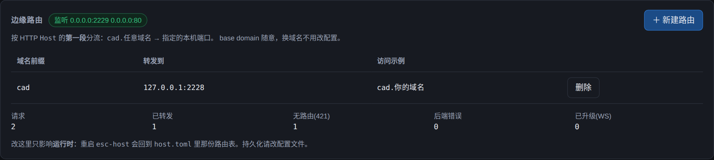
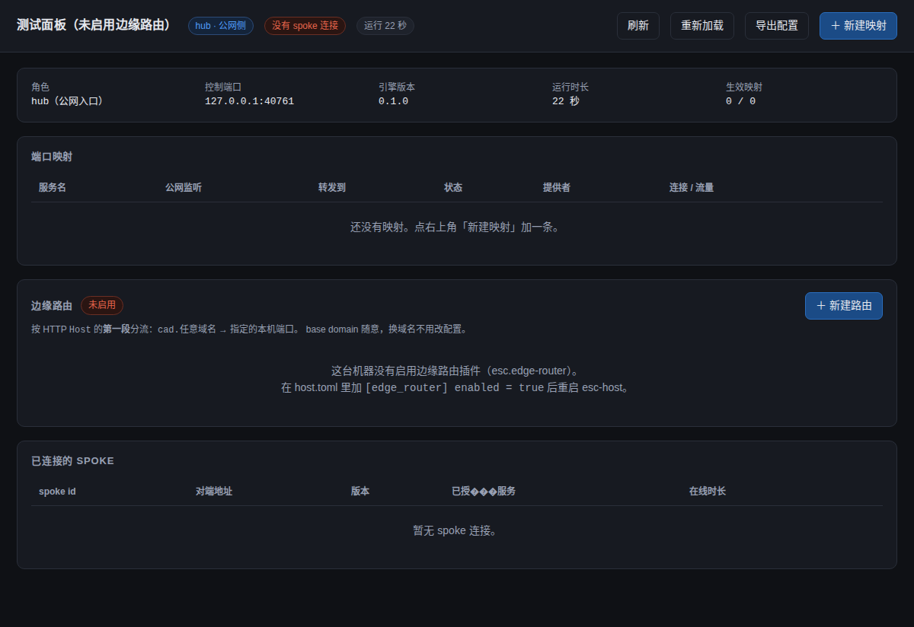

# 边缘路由插件（`esc.edge-router`）

同一台机器上跑多个服务时，用端口号区分记不住。这个插件按 **HTTP `Host` 的
第一段**把请求分到本机不同端口：

```
http://cad.你的域名:2229/     → 127.0.0.1:2228   摆线针轮工具
http://panel.你的域名:2229/   → 127.0.0.1:8080   EchoAgent 面板
http://report.你的域名:2229/  → 127.0.0.1:9000   任何本机服务
```

只看第一段，所以 base domain 完全不影响路由 —— 换域名、加域名都不用改配置：

| 访问地址 | 提取的键 | 后端 |
| --- | --- | --- |
| `cad.echo-tech.com:2229` | `cad` | 2228 |
| `cad.whatever.cn:2229` | `cad` | 2228 |
| `CAD.Example.COM.:2229` | `cad` | 2228 |
| `cad.114.132.241.46.nip.io:2229` | `cad` | 2228 |
| `114.132.241.46:2229` | （IP 没有前缀） | 421，或 `default_port` |
| `localhost:2229` | （只有一段） | 421，或 `default_port` |

## 与 `esc-gateway` 的分工

两者都"把流量送到别处"，但**目标地址的来源**完全不同：

| | `esc-gateway` | `esc.edge-router` |
| --- | --- | --- |
| 做什么 | 把**远端**节点的端口映射到本机（经 mTLS 隧道） | 把本机**不同端口**按域名分开 |
| 目标地址来自 | 隧道注册表（可能是另一台机器） | 恒为 `127.0.0.1`（本机） |
| 面向 | 内网穿透 / 端口暴露 | 单机多服务的统一入口 |

两者可以叠加：`cad.example.com → 2228` 由本插件分流，而 `2228` 上的服务
本身可以是 `esc-gateway` 暴露出来的远端端口。

## 配置

宿主配置（`/etc/esc/host.toml`，或 `esc-host -c <path>`）：

```toml
[edge_router]
enabled = true            # 默认 false：它要 bind 端口，不能"默认打开"

[edge_router.config]
listen = ["0.0.0.0:2229", "0.0.0.0:80"]   # 也可以写单个字符串
default_port = 9999                        # 可选：无前缀时兜底
timeout_ms = 300000                        # 可选：转发超时，0 = 不设超时

[edge_router.config.routes]
cad = 2228                     # 前缀匹配
panel = 8080
"cad.special.com" = 2229       # 键里带点 → 完整域名精确匹配（优先级高于前缀）
```

规则：

- **键**：`[a-z0-9._-]`，不能以点开头/结尾；大写会被转成小写（配置文件是人写的，
  不该因为大小写失败）。`*` 之类不允许 —— 匹配是精确的，通配只会制造 502。
- **完整域名优先**：`cad.special.com` 命中时不会再看前缀 `cad`。
- **`listen` 必填**：缺失直接挂载失败。默认绑 `:80` 太危险，宁可让配置错误暴露。
- **配置错就挂载失败**（fail-closed）：一个"起来了但全 421"的边缘路由比没起来更难查。
- **持久化是宿主的职责**：运行期增删路由只在内存里生效，改完 TOML 要重启。

## 运行期控制面（进程内 + 跨进程两条路）

### 进程内：Ctx 服务

插件把 `Arc<dyn EdgeRouteControl>` 注册到 `Ctx` 的 `esc.edge-router.control`
服务键下。trait 定义在 **`esc-control-api`**（不是插件里），因为面板要能
编译期读到同一份形状：

```rust
// esc-control-api
pub trait EdgeRouteControl: Send + Sync + 'static {
    async fn status(&self) -> Result<EdgeRouterStatus, ControlError>;
    async fn upsert_route(&self, spec: EdgeRouteUpsert) -> Result<EdgeRoute, ControlError>;
    async fn delete_route(&self, prefix: &str) -> Result<(), ControlError>;
}
```

宿主侧取用：`Host::edge_router()`（未启用时为 `None`）。

### 跨进程：`HostCall("esc.edge", …)`

子进程插件（面板）经宿主服务调同一组能力：

| `HostCall("esc.edge", method, params)` | 参数 | 返回 |
| --- | --- | --- |
| `edge.status` | — | `EdgeRouterStatus`（listens + routes + default_port + counters） |
| `edge.route.list` | — | `[EdgeRoute]`（只给路由，面板画表格） |
| `edge.route.upsert` | `{prefix, port}` | `EdgeRoute` |
| `edge.route.delete` | `{prefix}` | `null` |

- 服务名 `esc.edge` **只在 `[edge_router] enabled = true` 时注册** —— 面板据此
  判断这台机器有没有路由能力（而不是调了才发现 unimplemented）。
- 错误码走 `ErrorKind::as_code`：`invalid`/`not_found`/… 与隧道控制面完全一致，
  面板可以直接用 `ErrorKind::http_status()` 转 HTTP 状态码。
- **增删只在内存生效**：容器重启即回到 TOML 里那份。要在面板上"永久保存"，
  得由面板去改配置文件 —— 这条边界是刻意的（见下）。

> 为什么没有 `edge.route.save`：写盘涉及配置文件的原子替换、属主权限、
> systemd 的 `ReadOnlyPaths=/etc/esc`……这些都属于**宿主/部署层**的判断，
> 塞进代理插件会让它必须认识"配置在哪、能不能写"。宁可少一个便利方法。

## 面板 UI

隧道面板（`esc-plugin-tunnel-panel`，默认 `127.0.0.1:18787`）里有一张「边缘路由」卡片：
列出监听地址、路由表、计数器，可以点「新建路由」/「删除」直接改运行时路由表。



HTTP 端点（都经由 `HostCall("esc.edge", …)` 转发给背部宿主，面板不认识插件）：

| 方法 | 路径 | 转成的契约方法 |
| --- | --- | --- |
| `GET` | `/api/edge` | `edge.status` |
| `POST` | `/api/edge/routes` | `edge.route.upsert`（body `{prefix, port}`） |
| `DELETE` | `/api/edge/routes/{prefix}` | `edge.route.delete` |

面板侧的两条设计取舍：

1. **`call_edge` 在 `ControlBackend` 里是默认方法**（默认 `501`）。边缘路由是可选插件，
   假后端与"没启用插件"都不该被迫写一个永远失败的方法；而 `501 Not Implemented`
   恰好就是"这台机器没这个能力"的正确语义。
2. **`service_not_found` 特别翻成 501**。框架用它表示"宿主没注册这个服务"，
   如果落到 `ErrorKind::Other` 会变成 `502`，把用户引向"后端坏了"。前端靠
   `501` 把卡片显示成"未启用"而不是弹错误。

未启用时卡片长这样（不弹 toast、不影响顶部隧道状态徽标）：



> 面板只改**运行时**路由表；重启 `esc-host` 会回到 `host.toml` 里那份。
> 面板上没有"保存到配置文件"——写盘涉及属主/`ReadOnlyPaths`/原子替换，
> 那是部署层的事（见上面「为什么没有 edge.route.save」）。

### 一个前端坑（修过一次）

`.inline-form { display: flex }` 的优先级高于浏览器对 `[hidden]` 的
`display: none`，于是 `hidden` 属性完全失效——表单初始就显示、保存后也收不起来。
修法是加一条兜底：

```css
[hidden] { display: none !important; }
```

`tests/http_api.rs` 里有一条断言守着这行样式存在。

## 错误语义

| 状态码 | `error` 字段 | 什么时候 |
| --- | --- | --- |
| `421 Misdirected Request` | `no_route` | Host 没有对应路由（故意不用 404，避免与后端自己的 404 混淆） |
| `502 Bad Gateway` | `bad_gateway` | 后端连不上（响应体里带目标端口） |
| `504 Gateway Timeout` | `upstream_timeout` | 超过 `timeout_ms` |

所有错误都是 JSON，`curl` 一眼能看出问题：

```console
$ curl -s -H 'Host: nope.example.com' http://127.0.0.1:2229/
{"error":"no_route","message":"该域名前缀没有配置路由。…","host":"nope.example.com","prefix":"nope"}
```

## 首部处理

- **逐跳首部全部丢弃**（`connection` / `keep-alive` / `te` / `trailer` /
  `transfer-encoding` / `upgrade` / `proxy-*`），以及 `Connection:` 里点名的
  任意首部（`Connection: x-secret` 时 `x-secret` 也是逐跳的）。
- **`Host` 原样保留**（含端口）：后端可能用它拼绝对链接。
- **`X-Forwarded-*` 由网关重算**：客户端带来的同名值一律丢掉。
- **`X-Forwarded-For` 是追加**（`客户端, 已有值`），这是反向代理的通行做法，
  代价是前面几项可被客户端伪造 —— **后端只能信任最后一项**。
- 多值首部（`Set-Cookie`）逐条保留，不会只剩一个。
- 说明：hyper 输出的首部名统一小写（HTTP 首部名本就大小写不敏感）。

## 已知限制

| 限制 | 说明 |
| --- | --- |
| 只做 HTTP/1.1 | 没有 HTTP/2、没有 TLS 终结。要 HTTPS 就在前面放一层（见下）。 |
| 只连本机 | 目标恒为 `127.0.0.1:<port>`，不是通用出网代理（顺手关掉了 SSRF 面）。 |
| 路由表不持久化 | 运行期 `upsert_route` 只改内存，重启回到 TOML。 |
| 升级协商超时不可配 | 固定 15s（`UPGRADE_NEGOTIATION_TIMEOUT`）。它不该跟普通请求的 5 分钟共用。 |

### WebSocket / Upgrade（v2 已支持）

带 `Upgrade` 的请求会走独立路径（`forward_upgrade`），不是复用普通转发：

1. 从 request extensions 取 `OnUpgrade`（**必须在拆 body 之前**，`on()` 会取走它）；
2. 转发时**保留** `Upgrade` 与 `Connection` 两个首部（普通路径按逐跳首部丢掉，
   但升级路径它们就是协商载荷）；
3. 上游回 `101` 后，两侧的 `Upgraded` 用 `TokioIo` 包起来，
   `tokio::io::copy_bidirectional` 直接搬字节 —— 此后与 HTTP 状态机无关；
4. 上游回非 101（如 `426 Upgrade Required`）→ **原样返回**它的响应，这不是
   网关错误（测试里专门有一条守这个）。

计数器 `upgraded` 统计成功升级的连接数；被上游拒绝的计入 `proxied`。

日志：协商超时/连不上是 `warn`，成功升级是 `info`（`已升级连接（WebSocket 等）`），
连接结束（含双向字节数）是 `debug`。

## 与「备案拦截」的关系（腾讯云实测）

国内云厂商会按 `Host` 拦未备案域名（302 到 `dnspod.qcloud.com/webblock`），
**这与端口无关**：同一域名在 `:80` 和 `:2229` 上表现一致，只有 **HTTPS**
（Host 在 TLS 里，中间设备看不到）不触发。所以：

| 情况 | 做法 |
| --- | --- |
| 域名已 ICP 备案 | `http://cad.你的域名/` 直接用 |
| 域名未备案 | 走 HTTPS：在插件前面加一层 TLS 终结（nginx / `esc-tls`），或等插件支持 TLS |
| 自用 | 直接 `http://<ip>:<port>/`，不碰域名 |

> 坑 1：用**不存在的**假域名自测会得到"能用"的假阳性（不在备案库 → 放行）。
> 真实域名一解析就会被拦。
>
> 坑 2：**这套判定会随时间变**。同一个 `cad.echo-demo.com`，上午实测 200
> （放行），下午同一请求变成 302（拦截）；`cad.foo123.cn` 同样翻转，而
> `cad.whatever-abc.com` 仍 200。所以别拿"刚测过是 200"当结论 ——
> 判断自己的配置对不对，用 **loopback + `-H Host:`** 自测：
>
> ```console
> $ curl -s -H 'Host: cad.任意域名' http://127.0.0.1:2229/api/health
> {"status":"ok",...}        # 到了本机 = 配置对
> ```
>
> 公网拿到 302 到 dnspod 时，先做这个自测排除自己的问题。

## 部署

### 1. 编译 / 安装

```bash
cargo build --release -p esc-host
install -m755 target/release/esc-host /usr/local/bin/esc-host
```

> 二进制可以直接从别的机器搬（只要目标 glibc 不比编译机旧）：
> 在 Ubuntu 24.04（glibc 2.39）上编译的 `esc-host` 在 glibc 2.43 的机器上实测正常。
> 这条对云主机很实用 —— 1.9 GB 内存的机器上跑 release 构建要担心 OOM。

### 2. 配置 `[edge_router]`

见上面「配置」一节。**改完必须 `systemctl restart esc-host`**：插件在
mount 时读配置，没有热重载（运行期增删走 `EdgeRouterControl`）。

### 3. 绑 80 端口需要 capability

服务通常以非 root 用户运行（本仓 `deploy/esc-host.service` 用 `User=esc`）。
绑 <1024 端口要加：

```ini
AmbientCapabilities=CAP_NET_BIND_SERVICE
CapabilityBoundingSet=CAP_NET_BIND_SERVICE
```

验证只给了这一项：

```console
$ grep Cap /proc/$(systemctl show -p MainPID --value esc-host)/status
CapEff: 0000000000000400
CapAmb: 0000000000000400        # bit 10 = CAP_NET_BIND_SERVICE
```

不绑 80 的话把 `listen` 换成高位端口，这两行可以去掉。

### 4. 启动后的自检

```bash
systemctl status esc-host            # active、内存、重启次数
journalctl -u esc-host -n 30         # 应能看到 "edge router mounted" + 每条路由
```

日志长这样（`routes` 的条数与实际配置必须一致，这是"我以为配了"的对照）：

```
INFO esc_plugin_edge_router: edge router mounted listen=0.0.0.0:2229,0.0.0.0:80 routes=1
INFO esc_plugin_edge_router:   edge route prefix=cad port=2228
INFO esc_host: edge router ready listen=0.0.0.0:2229,0.0.0.0:80 routes=1
```

绕开公网自测（最可靠，不受云厂商 DNS/备案策略干扰）：

```bash
curl -s -H 'Host: cad.任意域名' http://127.0.0.1:2229/api/health
curl -s -H 'Host: 没配的前缀.x' http://127.0.0.1:2229/     # 期望 421
```

### 5. 访问日志

默认 `info` 级别只有挂载信息，**不打印每个请求**（避免日志爆量）。要看逐请求日志：

```bash
RUST_LOG=esc_plugin_edge_router=debug systemctl restart esc-host
# 或者临时：journalctl -u esc-host | grep prefix=
```

### 一个真实部署（cloud-server-2，2026-10-29）

从 `nginx:alpine` 容器迁到本插件的实际记录：

| | 迁移前 | 迁移后 |
| --- | --- | --- |
| 实现 | nginx 容器（host 网络）+ shell 管理脚本 | `esc-host` 进程内插件 |
| 监听 80/2229 的进程 | `nginx`（容器内） | `esc-host`（pid 即主进程） |
| 内存 | 容器约 6 MB | 约 2.5 MB |
| 改动 | — | 换二进制 + 加 `[edge_router]` + 给 capability |

迁移顺序（**顺序不能反**）：先停占端口的旧服务 → 换二进制 → 换配置 →
`restart`。如果先 restart 而端口仍被占，插件 bind 失败 → mount 失败 →
宿主 `bail!` 退出 → systemd 无限重启。迁移脚本带自动回滚。

## 实现要点（改代码前读）

1. **`mount()` 里同步 bind。**
   `mount()` 是同步签名，而 bind 失败（端口被占、没有绑特权端口权限）是必须
   让宿主知道的错误。若像隧道插件那样把启动整个塞进 `spawn`，mount 只能报
   "成功"，错误要等第一次请求才暴露。bind 是微秒级操作，阻塞代价可忽略。

2. **`Disposer` 的 `Drop` 会真的撤销注册。**
   写测试时如果把 `PluginRegistry` 放在辅助函数里、只返回 `Ctx`，注册表一出
   作用域服务就消失了（框架语义：注册即副作用、必须可逆）。表现是
   `resolve()` 报 `service key not available`，看着像没挂上，其实是测试自己撤了。
   真实宿主当然一直持有注册表 —— 测试也要。

3. **`plugin id` 与 crate 名对应**：`esc-plugin-edge-router` ↔ `esc.edge-router`。

4. **默认不挂载**：`Host::start` 只在 `[edge_router] enabled = true` 时才
   `register`，没启用就完全不存在（不注册 → 不挂载 → 不占端口）。

5. **`hyper::upgrade::on()` 会把 `OnUpgrade` 从 extensions 取走。**
   所以必须在把 request 拆成 parts/body **之前**调用，且这个 future 要一直
   活着到 101 响应发出去之后（这就是它为什么被移进 `tokio::spawn`）——
   提前 drop 掉会让连接永远等不到升级、表现成客户端一直挂着。

6. **契约放 `esc-control-api`，不放插件。**
   面板要编译期知道 `EdgeRoute` / `EdgeRouteControl` 的形状，但它不该依赖
   代理插件（那是"面板认识实现"）。所以类型与 trait 都在契约 crate 里，
   插件只是实现者；本仓的 `RouteView` / `RouterStatus` 之类的私有副本已删。
